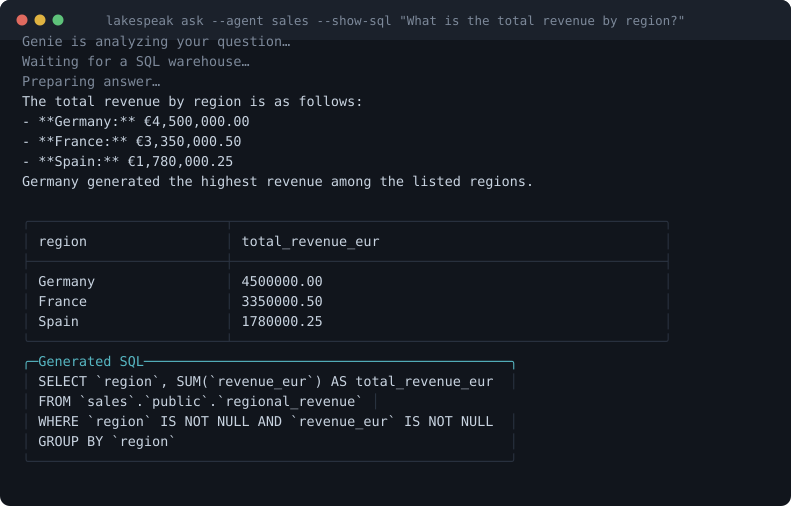

# LakeSpeak.NET

[](https://github.com/ivanvyd/LakeSpeak.NET/actions/workflows/ci.yml)
[](https://www.nuget.org/packages/LakeSpeak.Cli/)
[](https://www.nuget.org/packages/LakeSpeak.Genie/)
[](LICENSE)
[](https://scorecard.dev/viewer/?uri=github.com/ivanvyd/LakeSpeak.NET)
[](https://www.bestpractices.dev/projects/13969)

Use Databricks Genie conversations, generated SQL and query results in your .NET application.

**[lakespeak.net](https://lakespeak.net)** — what it does, with real terminal output.

`LakeSpeak.Genie` is an independent open-source client for
[Databricks Genie](https://docs.databricks.com/aws/en/genie/) Agents. The companion CLI runs
terminal conversations and version-controlled Question Packs that produce Markdown reports.

**Start with the [published-package .NET 8 quickstart](examples/package-quickstart/README.md):**
run an offline HTTP fixture without credentials, then use a Databricks CLI profile to ask a real
Genie Agent. [Getting started](docs/getting-started.md) covers prerequisites and the terminal flow.

> **Not a Databricks product.** LakeSpeak.NET is an independent open-source community project. It
> is not an official Databricks product, is not endorsed by Databricks, and is not supported under
> any Databricks service-level agreement. "Databricks", "Databricks Genie" and "Unity Catalog" are
> trademarks of Databricks, Inc.

---

## Status

**Current source version: v0.3.5.** The NuGet badges above show the latest published packages. See
[Verification status](#verification-status) for what has actually been tested and what has not.
Nothing here is stable until `v1.0`; the CLI surface and the `LakeSpeak.Genie` public API may both
change, and before `v1.0` a minor version is allowed to break them.

The `LakeSpeak.Genie` library multi-targets `net8.0` and `net10.0`. The `LakeSpeak.Cli` tool
is `net10.0`-only. See [ADR 0006](docs/decisions/0006-multi-target-net8-and-net10.md) for the
reasoning.

```bash
dotnet add package LakeSpeak.Genie --version 0.3.5
```

## In .NET

Integration excerpt: after [logging into a CLI profile](docs/authentication.md#interactive-use-the-databricks-cli),
supply your existing Genie Agent id as `salesAgentId` and your application's `CancellationToken`
as `cancellationToken`. The [package quickstart](examples/package-quickstart/README.md) is runnable
without these placeholder variables.

```csharp
using LakeSpeak.Genie;
using Microsoft.Extensions.DependencyInjection;

var services = new ServiceCollection();
services.AddDatabricksCliAuthentication("my-workspace");
services.AddLakeSpeak(options => options.Profile = "my-workspace");

using var provider = services.BuildServiceProvider();
var genie = provider.GetRequiredService<IGenieClient>();
var response = await genie.AskAsync(
    agentId: salesAgentId,
    question: "Which customers had the largest revenue decline?",
    cancellationToken: cancellationToken);

Console.WriteLine(response.Text);
Console.WriteLine(response.Query?.Sql);
```

The [complete package consumer](examples/package-quickstart/README.md) pins published 0.3.5,
displays rows, and handles cancellation, typed failures and incomplete results. It uses no source
project reference. The [source-reference example](examples/dotnet-quickstart/) remains in the
solution so API changes are compiled in CI. Neither example judges the correctness of generated SQL.

## What this is, in one paragraph

[Databricks Genie](https://docs.databricks.com/aws/en/genie/) answers questions about your data in
plain English: you ask, it writes SQL against tables someone has curated, runs it on a SQL
warehouse, and answers. A **Genie Agent** is one such configured surface. Genie normally lives in
the Databricks web UI — LakeSpeak puts it in your .NET code, your scripts and your terminal, while
keeping the generated SQL visible so you can check the answer.

You need a Genie Agent to already exist in your workspace and be shared with you. LakeSpeak cannot
create one, and sees only what your own Databricks identity can see.

## Why this exists

Use LakeSpeak when your .NET application needs a typed Genie client in-process, with dependency
injection, cancellation and typed failures, or when you want YAML questions to produce a Markdown
report through the companion CLI.

For a terminal answer, the [official Databricks CLI](https://docs.databricks.com/aws/en/dev-tools/cli/reference/genie-commands)
already provides `genie ask`:

```bash
databricks genie ask -s sales --include-sql "How did revenue change last month?"
```

Databricks also provides [native Genie benchmark evaluations](https://docs.databricks.com/api/genie/v1/genie-get-eval-run).
Question Packs provide a YAML-to-Markdown reporting workflow; they do not score answer accuracy or
replace those evaluations. Databricks publishes a [C# Zerobus ingestion SDK](https://github.com/databricks/zerobus-sdk),
which serves a different API. LakeSpeak's scope is Genie conversations and their results.

The companion terminal client supports [configured Agent aliases](docs/configuration.md):

```bash
lakespeak ask --agent sales "How did revenue change last month?"
```



The generated SQL is shown because the answer is only as trustworthy as the query behind it.

It is deliberately narrow. It is not a Databricks SDK for .NET and not a replacement for the
official CLI. It is also not a Genie MCP server: Databricks ships [managed MCP endpoints for
Genie](https://docs.databricks.com/aws/en/generative-ai/mcp/), and although those are stateless —
every question starts over — building a stateful one would be a second product, and this is
deliberately one. See [ADR 0001](docs/decisions/0001-a-cli-and-a-library-rather-than-another-mcp-server.md),
including its correction.

## Install

```bash
dotnet add package LakeSpeak.Genie --version 0.3.5
```

For the companion .NET 10 CLI:

```bash
dotnet tool install --global LakeSpeak.Cli --version 0.3.5
```

## Terminal quick start

LakeSpeak uses your existing Databricks CLI login rather than asking for a token of its own:

```bash
databricks auth login --profile company
lakespeak chat --profile company
```

For unattended use — a scheduled Question Pack, a CI job — set `DATABRICKS_CLIENT_ID` and
`DATABRICKS_CLIENT_SECRET` to a Databricks service principal and LakeSpeak will mint and refresh
its own OAuth tokens; see [Authentication → OAuth M2M](docs/authentication.md#unattended-use-oauth-m2m-native).

Ask a one-shot question:

```bash
lakespeak ask --profile company --agent sales "Who were our five fastest-growing customers?"
```

Get machine-readable output for scripts and coding agents:

```bash
lakespeak ask --profile company --agent finance --format json "What was recognized revenue yesterday?"
```

```powershell
$r = lakespeak ask --profile company --agent finance --format json "Revenue yesterday?" | ConvertFrom-Json
$r.result.rows
```

## Question Packs

A Question Pack turns a set of business questions into a reviewable, version-controlled report.

```yaml
apiVersion: lakespeak.net/v1alpha1
kind: QuestionPack
metadata:
  name: daily-platform-brief
spec:
  agent: platform-operations
  questions:
    - id: failed-jobs
      title: Failed production jobs
      ask: Which production jobs failed during the last 24 hours?
  output:
    format: markdown
    path: reports/daily-platform-brief.md
```

```bash
lakespeak pack run daily-platform-brief.yaml --profile company
```

See the [Question Pack guide](docs/question-packs.md) for the schema and failure semantics.
The opt-in `behavior.requireQueryResult` policy is **Unreleased**; it is not accepted by the
published 0.3.5 CLI. It requires a complete query result while allowing a valid zero-row result.

## What it does not do

- It does not bypass Unity Catalog. You see exactly what your Databricks identity is permitted to
  see, and LakeSpeak has no way to widen that.
- It does not guarantee that a Genie answer is correct. Natural-language querying produces
  generated SQL, and generated SQL can be wrong in ways that read as plausible. LakeSpeak preserves
  the SQL, the source metadata and the message ids precisely so you can check.
- It does not execute arbitrary SQL, edit generated SQL, or modify Genie Agent definitions.
- It does not store your questions, answers, or query results anywhere except files you explicitly
  export.

## Security and privacy

LakeSpeak never persists an access token. It brokers short-lived OAuth tokens through the Databricks
CLI and holds them in memory for the life of the process.

Your questions and the answers you get back can contain sensitive business information, and exported
results contain governed data. Once you export a CSV, that file is yours to look after. In CI,
remember that job logs are usually readable by everyone with repository access.

Every release is signed with a SLSA build provenance attestation, and
[one command](SECURITY.md#verifying-a-release) checks that a download really came from this
repository's release workflow.

Report vulnerabilities privately — see [SECURITY.md](SECURITY.md). For how the project's controls
map to the SOC 2 Trust Services Criteria, and the several places they deliberately stop, see
[docs/compliance/soc2-mapping.md](docs/compliance/soc2-mapping.md).

## Verification status

This table records what has been run against what. It is not a support matrix and it is not a
promise; it is a record of evidence.

| Area | Status |
|---|---|
| Unit and contract tests | Run on Windows, Linux and macOS in CI, on every push and pull request |
| Azure Databricks, live workspace | `agents list`, `ask`, `pack run` and every output format verified against a real Genie Agent on 2026-08-01 |
| `chat` | Verified live on 2026-08-06 — the REPL, a follow-up keeping its context, and `/sql`. Its other slash commands were not exercised |
| Feedback, full-result download, visualizations | Contract tests only — **not** exercised live |
| Chunked results assembled beyond the first chunk | Verified live on AWS on 2026-09-01: Genie omitted the next-chunk link, LakeSpeak recovered it from the statement id, and assembled four chunks into all 1,000 rows without truncation |
| Unattended service-principal authentication (OAuth M2M) | Verified against the live AWS workspace on 2026-09-01. A GitHub Actions run completed all 9 live tests using native token acquisition and refresh |
| Live smoke, re-runnable from `Actions` | Behind `secrets.DATABRICKS_CLIENT_ID`, `secrets.DATABRICKS_CLIENT_SECRET`, `vars.LAKESPEAK_LIVE_HOST` and `vars.LAKESPEAK_LIVE_AGENT`; weekly and on demand. Forks without the variables see a notice and exit 0 |
| AWS Databricks | Verified live on 2026-09-01, including native OAuth M2M and multi-chunk result assembly — see [docs/compatibility.md](docs/compatibility.md) |
| GCP Databricks | Not tested — [#52](https://github.com/ivanvyd/LakeSpeak.NET/issues/52) |
| Windows / Linux / macOS | Covered by the CI matrix |

Paths that have not been exercised against a real workspace are labelled as such in
[docs/compatibility.md](docs/compatibility.md) rather than being quietly presented as working.

## Documentation

- [Getting started](docs/getting-started.md) — zero to a working answer
- [Commands](docs/commands.md) — every command, flag and exit code
- [Configuration](docs/configuration.md) — the config file, aliases and defaults
- [`examples/`](examples/) — a runnable .NET console sample, a complete Question Pack, and a
  [scheduled GitHub Actions workflow](examples/github-actions/daily-brief.yml)
- [Container image](docs/containers.md) — running a Question Pack on a schedule
- [Authentication](docs/authentication.md) — profiles, environment tokens, and what is not supported
- [Question Packs](docs/question-packs.md) — the schema and its failure semantics
- [Troubleshooting](docs/troubleshooting.md)
- [Limitations](docs/limitations.md) — read this one
- [Decisions](docs/decisions/) — ADRs for the load-bearing choices
- [Genie API surface](docs/planning/genie-api-surface.md) — every wire claim, labelled verified or not
- [SOC 2 control mapping](docs/compliance/soc2-mapping.md)
- [Releasing](RELEASING.md) — how a version is cut, and how to rehearse one

## Contributing

Issues and pull requests are welcome. Start with [CONTRIBUTING.md](CONTRIBUTING.md), and see
[GOVERNANCE.md](GOVERNANCE.md) for how decisions get made and what is deliberately out of scope.

Good first issues are labelled [`good first issue`](https://github.com/ivanvyd/LakeSpeak.NET/labels/good%20first%20issue).
Core authentication and security work is not labelled that way, on purpose.

## License

[Apache License 2.0](LICENSE). See [NOTICE](NOTICE).
