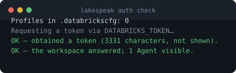
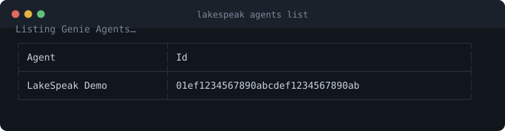
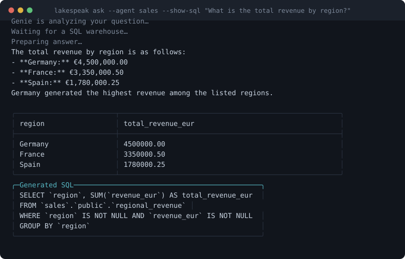
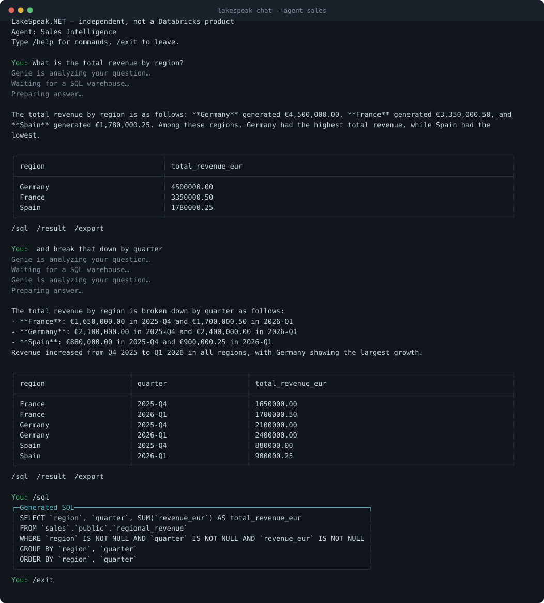

# Getting started

Start with a .NET application using the published package, then connect it to an existing Genie
Agent. An offline fixture lets you check the integration before supplying workspace credentials.

## Using it from .NET

The [standalone .NET 8 quickstart](../examples/package-quickstart/README.md) pins published
`LakeSpeak.Genie` 0.3.5. Copy that directory and follow its restore, build and `--fixture`
commands. The fixture uses HTTP responses in memory and needs no Databricks account or CLI.
Its output is explicitly marked **OFFLINE**; it does not verify a live warehouse.

For an existing application targeting .NET 8 or .NET 10:

```bash
dotnet add package LakeSpeak.Genie --version 0.3.5
```

After the workspace prerequisites below and `databricks auth login --profile my-workspace`,
register the package's CLI authentication provider and typed client:

```csharp
using LakeSpeak.Genie;
using Microsoft.Extensions.DependencyInjection;

var services = new ServiceCollection();
services.AddDatabricksCliAuthentication("my-workspace");
services.AddLakeSpeak(options => options.Profile = "my-workspace");
using var provider = services.BuildServiceProvider();
var genie = provider.GetRequiredService<IGenieClient>();

var response = await genie.AskAsync(agentId, question, cancellationToken: cancellationToken);
Console.WriteLine(response.Text);
Console.WriteLine(response.Query?.Sql);
```

This is an abbreviated integration fragment. The complete quickstart supplies command arguments,
cancellation, row display and `GenieException` handling. `GenieException.Kind` distinguishes failures
such as authorization and polling timeout; [authentication](authentication.md) covers other token
sources and unattended OAuth M2M. Invalid host configuration is a startup error when the client is
resolved, rather than a Genie response.

Use `FollowUpAsync(agentId, conversationId, question)` to keep conversation context. Inspect
`response.Result?.IsTruncated` before relying on rows. A complete message can contain a
clarification without a query result; completion alone does not establish a usable data answer.

The [source-reference example](../examples/dotnet-quickstart/) is separate and builds in the
repository solution so CI catches API drift. Use the package quickstart to test a published version.

## What this actually is

**Databricks Genie** is a Databricks feature that answers questions about your data in plain
English. You ask "which customers churned last quarter", it writes SQL against tables someone has
curated for it, runs that SQL on a SQL warehouse, and answers. A **Genie Agent** — the REST API
still calls it a *space* — is one such configured question-answering surface: a set of tables, some
instructions, and a warehouse to run on.

LakeSpeak puts Genie conversations in your .NET code, with a companion terminal application.
The [official CLI](https://docs.databricks.com/aws/en/dev-tools/cli/reference/genie-commands)
already has `databricks genie ask`, and Databricks provides
[native benchmark evaluations](https://docs.databricks.com/api/genie/v1/genie-get-eval-run).
LakeSpeak focuses on a typed in-process Genie client and YAML-to-Markdown Question Pack reports.

```
   You                LakeSpeak              Databricks Genie
    │                     │                         │
    │  "revenue by        │                         │
    │   region?"          │                         │
    ├────────────────────►│  start conversation     │
    │                     ├────────────────────────►│
    │                     │                         │ generates SQL
    │                     │  poll until done        │ runs it on a warehouse
    │                     ├────────────────────────►│
    │  answer + the SQL   │                         │
    │◄────────────────────┤◄────────────────────────┤
```

LakeSpeak returns data to your application under your Databricks identity. It has no credential
store; your application and exported reports remain responsible for handling governed data.

## What you need before you start

Three things, and the second is the one people get stuck on:

1. **A Databricks workspace** you can log into.
2. **A Genie Agent that exists and is shared with you.** LakeSpeak cannot create one — that is
   done in the Databricks UI under **Genie**, by someone who knows which tables should be
   queryable. If nobody has made one, this tool has nothing to talk to.
3. **The [Databricks CLI](https://docs.databricks.com/dev-tools/cli/install.html)**, for the login.
   You can skip it if you supply a token yourself (see [authentication](authentication.md)).

To check whether you have a Genie Agent at all, open your Databricks workspace and look for
**Genie** in the sidebar. If the list is empty, stop here and go and get one created — everything
below will otherwise fail at the last step with "no Genie Agents are visible to this identity",
which is accurate but not much comfort.

## 1. Install

```bash
dotnet tool install --global LakeSpeak.Cli
lakespeak --version
```

Needs the [.NET 10 runtime or SDK](https://dotnet.microsoft.com/download). If you would rather not
install .NET at all, each release also ships a self-contained binary for Windows, Linux and macOS —
see the [releases page](https://github.com/ivanvyd/LakeSpeak.NET/releases).

## 2. Log in

```bash
databricks auth login --profile my-workspace
```

That opens a browser once and caches a short-lived OAuth token. LakeSpeak borrows that token; it
never stores one of its own.

Check it worked:

```bash
lakespeak auth check --profile my-workspace
```

This tells you which profiles exist, which workspace each resolves to, whether a token can actually
be obtained, and whether the workspace answers. It prints the token's *length* and never any part
of its value, so the output is safe to paste into an issue.



## 3. Find your Agent

```bash
lakespeak agents list --profile my-workspace
```



An empty list is not an error — it means no Genie Agent is shared with your identity. That is fixed
in Databricks, not here.

## 4. Ask something

```bash
lakespeak ask --profile my-workspace --agent "Sales Intelligence" --show-sql "How did revenue change last quarter?"
```



Note `4500000.00` — not `4.5E6`, not `4,500,000`. Cells reach you exactly as Databricks returned
them; nothing is reparsed on the way out.

**Always read the SQL before acting on a number.** Generated SQL can be wrong in ways that read as
entirely correct — a subtly wrong join, a date boundary off by one, a filter that quietly excludes
cancelled orders. `--show-sql` exists for exactly this, and LakeSpeak preserves the statement, the
bound values and the message ids precisely so you can check.

## 5. Keep talking

```bash
lakespeak chat --profile my-workspace --agent "Sales Intelligence"
```

Follow-up questions keep their context, so "and break that down by product" works. Type `/help`
for the slash commands, `/sql` to see the statement behind the last answer, `/export report.csv`
to save the result, `/exit` to leave.



`chat` needs a real terminal. For scripts, use `ask`.

## Where to go next

| You want to | Read |
|---|---|
| Script this, or pipe it into another tool | [Commands](commands.md) — every flag and exit code |
| Use it from C# | [In .NET](#using-it-from-net) below |
| Run the same questions on a schedule | [Question Packs](question-packs.md) |
| Understand what it will not do | [Limitations](limitations.md) — worth reading early |
| Something broke | [Troubleshooting](troubleshooting.md) |

## Scripting it

Results go to stdout, diagnostics to stderr, so this works cleanly:

```bash
lakespeak ask --profile my-workspace --agent finance --format json "Recognized revenue yesterday?" 2>/dev/null \
  | jq -r '.result.rows[][]'
```

```powershell
$r = lakespeak ask --profile my-workspace --agent finance --format json "Revenue yesterday?" | ConvertFrom-Json
$r.result.rows
```

Exit codes are contractual — `0` success, `2` bad input, `3` auth, `4` permission, `5` not found,
`7` timeout. The full table is in [commands.md](commands.md).
